# Prompts utilizados

**Alumno:** José Rojas Condor · **Rama:** `mejora-ia` · **Herramienta:** Gemini en Android Studio (modo agente)

Implementé las **6 mejoras** propuestas en el laboratorio, más dos ajustes que encontré al comparar la app con los mockups: la pantalla de inicio y el botón de notificaciones.

### Contexto que pegué antes de cada prompt

Para que Gemini no rompiera la arquitectura, todos los prompts empiezan con este bloque:

```
Tengo una app Android llamada AyudaCampus en Kotlin con Jetpack Compose y Material 3 (sin XML), arquitectura MVVM + Repository con Room 2.6.1 y DataStore. Paquete: com.rojas.ayudacampus.
Reglas obligatorias:
- La View (paquete ui/) solo usa su ViewModel; nunca DAO ni Repository.
- El ViewModel solo conoce la interface AyudaRepository, no el DAO.
- Si agregas una función al repositorio, primero la declaras en AyudaRepository y luego la implementas en AyudaRepositoryRoom.
- Lectura que debe actualizar la pantalla = Flow (sin suspend). Escritura o acción única = suspend.
- Colores siempre con MaterialTheme.colorScheme o los colores de ui/theme/Color.kt, nunca colores sueltos.
- No cambies nada que no te pida. Muéstrame solo los archivos que cambian, completos.
```
 
---

## Prompt 1 — Tiempo promedio de resolución

**Texto enviado a Gemini:**
```
Agrega en el panel de soporte el tiempo promedio de resolucion de los tickets cerrados (fechaCierre - fecha). La consulta va en TicketDao, la funcion en AyudaRepository y su implementacion en AyudaRepositoryRoom, y el valor se expone como StateFlow en PanelViewModel. La View solo lo muestra en una tarjeta con icono de reloj, en formato "X h Y min".
```

**Que genero la IA:** Una consulta `AVG(fechaCierre - fecha)` en `TicketDao` que devuelve `Flow`. La declaró en `AyudaRepository`, la implementó en `AyudaRepositoryRoom` y la expuso como `StateFlow` en `PanelViewModel`. En `PanelScreen` agregó una tarjeta con el icono de reloj.

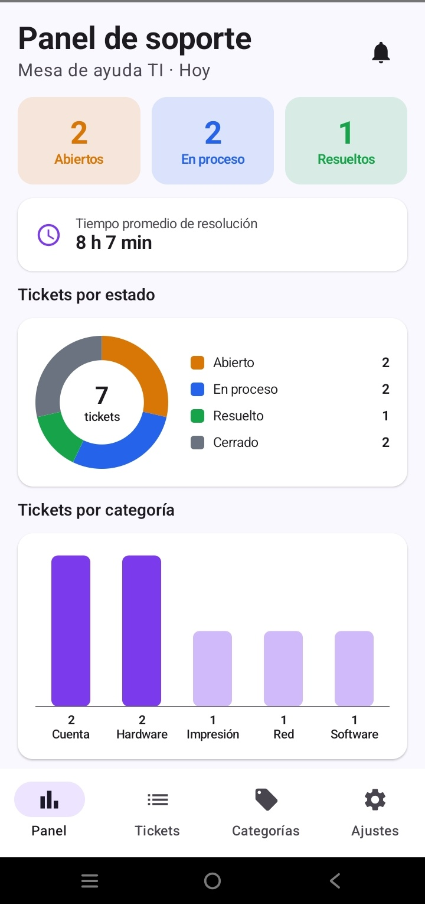

**Que tuve que corregir yo:** La lógica estaba bien. Gemini colocó la tarjeta debajo de todo y dejó la alerta de tickets ALTA al final del panel. La moví a mano arriba, porque la alerta es lo primero que Soporte debe ver.

**Respeta MVVM?:** Sí. La consulta está en el DAO, la función primero en la interface y el cálculo llega a la View como `StateFlow`. La pantalla solo lo muestra.
 
---

## Prompt 2 — Contador de SLA por prioridad

**Texto enviado a Gemini:**
```
Agrega un contador de SLA a cada ticket. El tiempo maximo de atencion depende de la prioridad: Alta 4 h, Media 24 h, Baja 72 h. El calculo del tiempo restante va en el ViewModel (no en el Composable) y la tarjeta TicketCard solo muestra el texto: "Vence en X h Y min" si todavia esta en plazo, o "Vencido hace X h Y min" en rojo si ya paso. Los tickets Resueltos o Cerrados no muestran SLA.
```

**Que genero la IA:** La función que calcula el plazo según la prioridad y un chip en `TicketCard` con el tiempo restante, en rojo cuando está vencido.

| Antes (texto partido) | Después de la corrección |
|---|---|
| 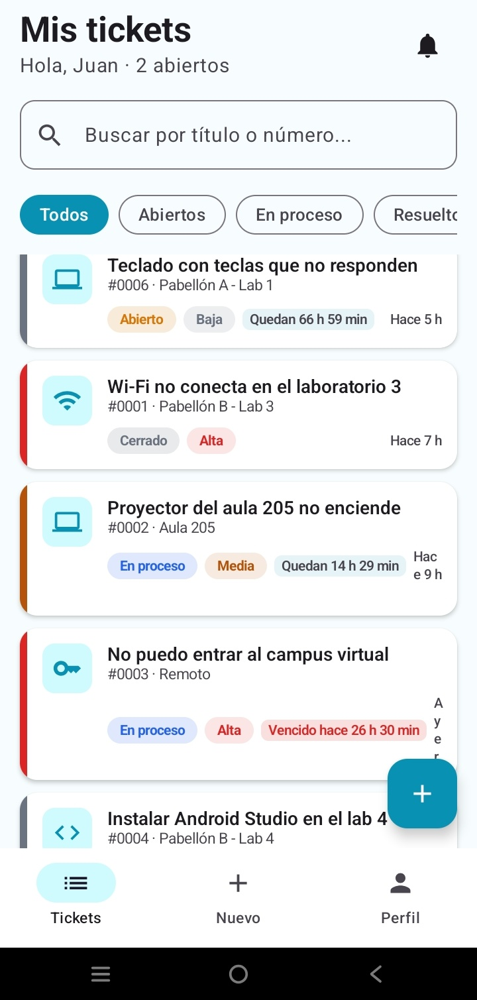 | 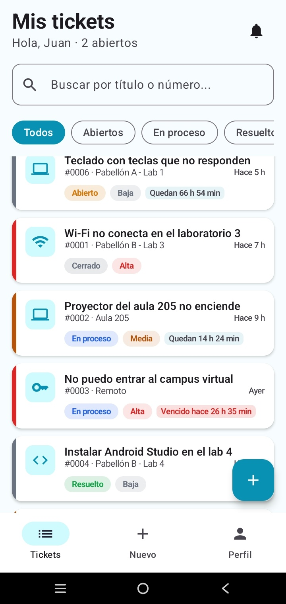 |

**Que tuve que corregir yo:** El texto "Hace 9 h" se partía **letra por letra** hacia abajo porque el chip del SLA no le dejaba espacio en la fila. Con un segundo prompt le pedí que el texto ocupara una sola línea y que el tiempo se mostrara en la fila del número del ticket.

**Respeta MVVM?:** Sí. Las horas límite por prioridad (regla de negocio) están en el ViewModel; la tarjeta solo pinta el texto y el color.
 
---

## Prompt 3 — Búsqueda avanzada en la bandeja

**Texto enviado a Gemini:**
```
En la bandeja de soporte agrega busqueda avanzada: Soporte debe poder filtrar por prioridad, por categoria y por texto (titulo o numero) al mismo tiempo. Los filtros se guardan como StateFlow en BandejaViewModel y se combinan con combine sobre la lista de tickets. La View solo muestra los FilterChip y el campo de busqueda y avisa al ViewModel.
```

**Que genero la IA:** Tres `MutableStateFlow` (texto, prioridad y categoría) en `BandejaViewModel` combinados con `combine`, y en `BandejaScreen` un campo de búsqueda con filas de `FilterChip`.

| Filtros combinados | Sin resultados |
|---|---|
| 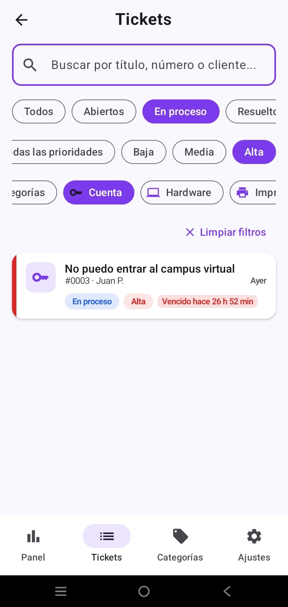 | 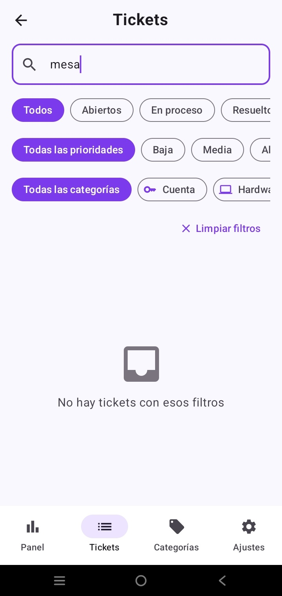 |

**Que tuve que corregir yo:** Faltaba el chip **Cerrados**: en la Fase 1 no existía, porque la bandeja solo trabaja con tickets activos. Lo agregué para poder buscar también en el historial. También comprobé que los filtros se reinician al salir de la pantalla: es correcto, porque viven en memoria en el ViewModel y no en DataStore.

**Respeta MVVM?:** Sí. El filtrado se hace en el ViewModel y la pantalla no conoce el Repository.
 
---

## Prompt 4 — Registro de estudiante

**Texto enviado a Gemini:**
```
Agrega una pantalla de registro de estudiante. Desde el Login un enlace "Registrarse" abre RegistroScreen con nombre, correo, contraseña y confirmar contraseña. Validaciones en un RegistroViewModel: campos obligatorios, correo con formato valido, correo unico (consulta existeCorreo en UsuarioDao) y contraseñas iguales. El usuario se crea con rol CLIENTE. Las funciones nuevas van primero en AyudaRepository y luego en AyudaRepositoryRoom.
```

**Que genero la IA:** `existeCorreo` e `insertar` en `UsuarioDao`, la función `registrar` en `AyudaRepository` y `AyudaRepositoryRoom`, un `RegistroViewModel` con las validaciones, la `RegistroScreen`, la ruta `REGISTRO` y el enlace en el Login.

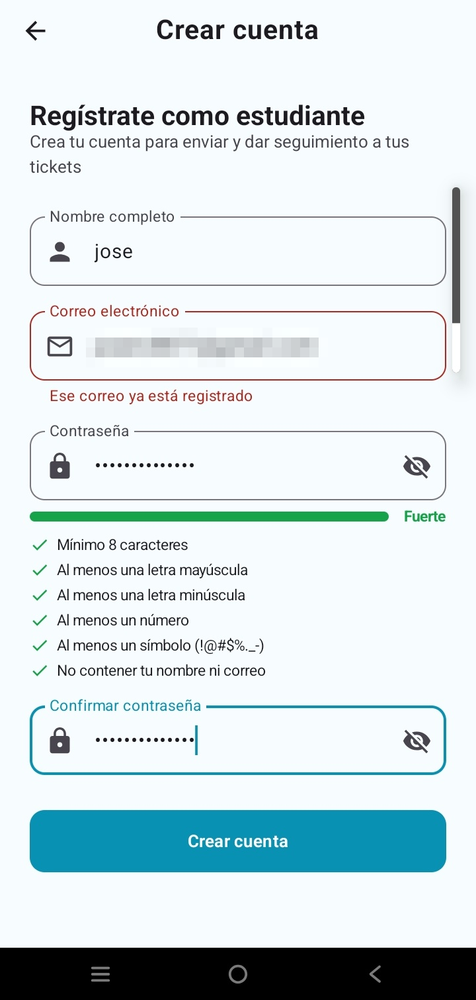

**Que tuve que corregir yo:** Al probar, la app aceptaba contraseñas débiles como `1234`. Con un segundo prompt pedí una contraseña fuerte (mínimo 8 caracteres, una mayúscula, un número y un símbolo), validada en el ViewModel y con el error mostrado debajo del campo.

**Respeta MVVM?:** Sí. Las validaciones están en el ViewModel; la consulta de correo único está en el DAO y pasa por la interface.
 
---

## Prompt 5 — Comentarios internos de Soporte

**Texto enviado a Gemini:**
```
Agrega comentarios internos: Soporte puede escribir notas privadas en un ticket que el estudiante NO ve.
- Entidad Comentario: nuevo campo val interno: Boolean = false.
- AyudaDatabase: sube version a 2 y agrega .fallbackToDestructiveMigration() al databaseBuilder (es una app de práctica).
- AyudaRepository: cambia agregarComentario para recibir también interno: Boolean = false (el valor por defecto va solo en la interface; en AyudaRepositoryRoom el override no repite el valor por defecto). Guarda el campo en el Comentario.
- TicketDetalleViewModel (estudiante): el ticket que expone ya no debe incluir los comentarios con interno = true (fíltralos en el ViewModel con map sobre el Flow). El estudiante nunca debe recibir una nota interna.
- AtenderViewModel: responder(texto: String, interno: Boolean).
- AtenderTicketScreen: junto al campo de respuesta agrega un Switch o FilterChip "Nota interna" con icono de candado; cuando está activo, el placeholder dice "Escribe una nota interna (el estudiante no la verá)...". Se sigue viendo toda la conversación, incluidas las notas internas.
- BurbujaComentario: si el comentario es interno, dibújalo con fondo ámbar suave (EstadoAbierto con alpha) y un icono de candado con el texto "Nota interna" en el encabezado.
- DatosIniciales: agrega una nota interna de ejemplo de Soporte en el ticket "Proyector del aula 205 no enciende" ("Revisar garantía del proyector con el proveedor").
```

**Que genero la IA:** El campo `interno` en la entidad, la base en versión 2, el parámetro en el Repository, el filtro en `TicketDetalleViewModel`, el chip "Nota interna" en Atender y la burbuja ámbar con candado.

Mismo ticket #0002 visto por los dos perfiles:

| Soporte ve las notas internas | El estudiante no las ve |
|---|---|
| 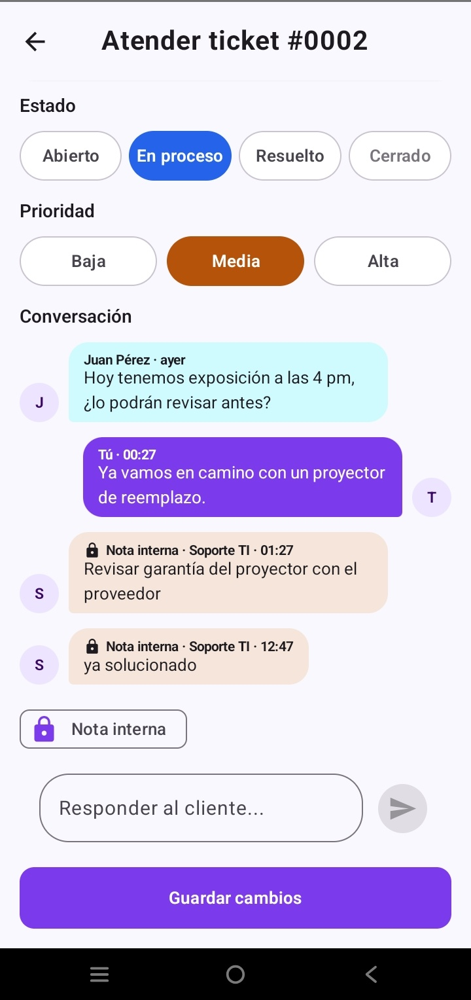 | 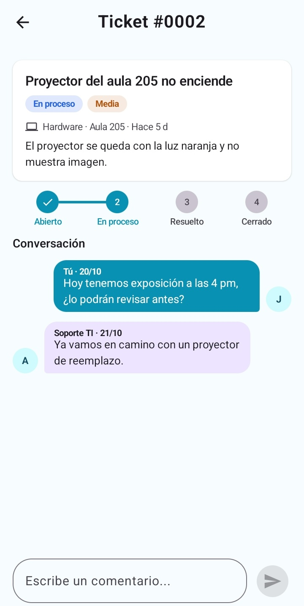 |

Nota interna escrita por mí, después de corregir el avatar y la alineación (ver Prompt 6):

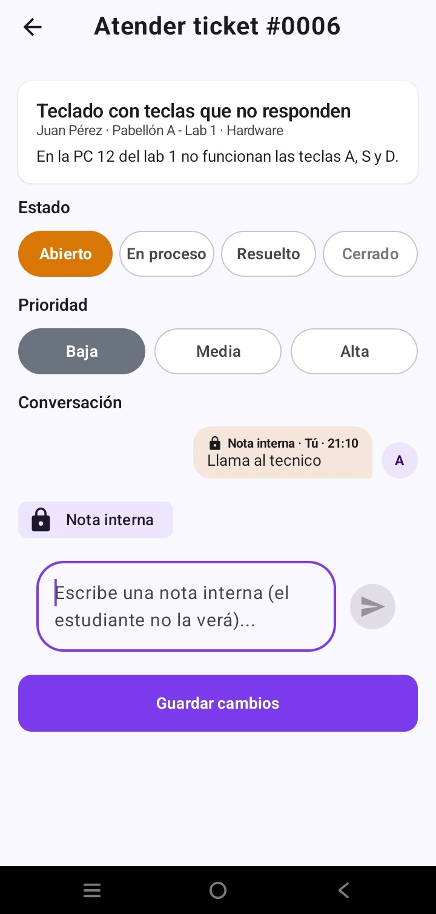

**Que tuve que corregir yo:**
- A mitad del cambio, Gemini se detuvo por **límite de cuota** (`RESOURCE_EXHAUSTED`) y dejó archivos a medias que no compilaban. Usé **Revert all**, comprobé con `git status` que el proyecto quedó limpio y repetí el prompt completo con otro modelo.
- Revisé dos errores típicos: que el `= false` no se repitiera en el `override` de `AyudaRepositoryRoom` (Kotlin no lo permite) y que el filtro estuviera en el ViewModel y no en `DetalleTicketScreen`. Los dos estaban bien.
- Al cambiar la versión de la base, desinstalé la app para que se volviera a sembrar con la nota de ejemplo.
  **Respeta MVVM?:** Sí. El filtro está en el ViewModel, así que el estudiante **nunca recibe** la nota; la pantalla no tiene que ocultarla. `AtenderViewModel` no filtra porque Soporte sí debe ver todo.

---

## Prompt 6 — Animaciones, estados vacíos e identidad visual

Lo dividí en tres prompts para que Gemini no se cortara por cuota y se equivocara menos. Todos cambian **solo la capa View**.

**Texto enviado a Gemini (6A — estados vacíos y stepper):**
```
Mejora visual SOLO en la capa View (paquete ui/). No cambies ViewModels, Repository, DAO ni build.gradle; no agregues librerías nuevas.
1) Crea ui/components/EstadoVacio.kt: EstadoVacio(icono, titulo, mensaje). Ilustración con un Canvas de 3 círculos concéntricos de primaryContainer y el icono en un círculo primary que flota con rememberInfiniteTransition; entra con fadeIn + scaleIn.
2) Úsalo en MisTicketsScreen ("Todo en orden" / "Sin resultados"), BandejaScreen ("Bandeja limpia") y en la conversación vacía ("Aún no hay mensajes").
3) StepperTicket animado: la línea se llena con animateFloatAsState, el paso actual late, el check aparece con rebote y los colores cambian con animateColorAsState.
```

**Texto enviado a Gemini (6B — transiciones y panel):**
```
Sigue con la mejora visual, SOLO en ui/.
1) NavAyuda: transiciones de deslizar + fade entre pantallas (tween 300 ms).
2) Modifier.animateItem() en los LazyColumn de MisTickets, Bandeja y Categorías.
3) PanelScreen: contadores que cuentan desde 0 con animateIntAsState y la alerta con AnimatedVisibility.
4) GraficoDona se dibuja girando y las barras de GraficoBarras crecen una tras otra.
5) EstadoChip y PrioridadChip cambian de color animado; las Estrellas rebotan al tocarlas.
```

**Texto enviado a Gemini (6C — identidad visual):**
```
Identidad visual SOLO en ui/:
1) Cabecera con Brush.verticalGradient de primary a primaryContainer y esquinas inferiores de 28.dp en MisTicketsScreen y PanelScreen, con "Hola, {nombre}" y un subtítulo según el perfil. El nombre llega por parámetro desde NavAyuda.
2) TicketCard: franja vertical de 4.dp a la izquierda con colorPrioridad.
3) BurbujaComentario: avatar circular de 32.dp con la inicial del autor.
```

**Que genero la IA:** El componente `EstadoVacio`, el stepper animado, las transiciones, los gráficos animados, la cabecera con degradado, la franja de prioridad y los avatares.

| Cabecera y franja de prioridad | Panel de Soporte |
|---|---|
| 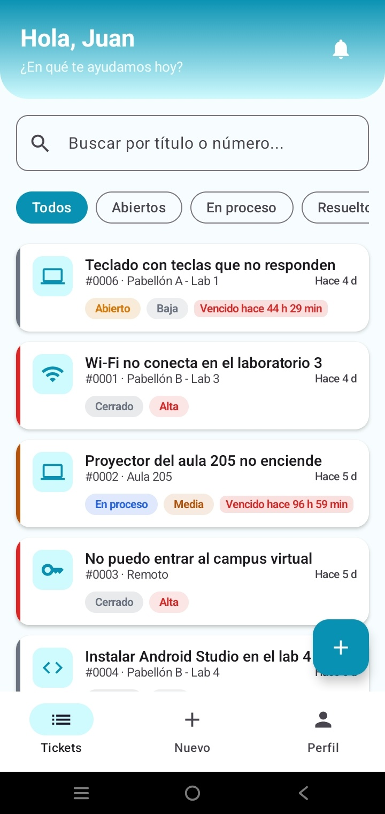 | 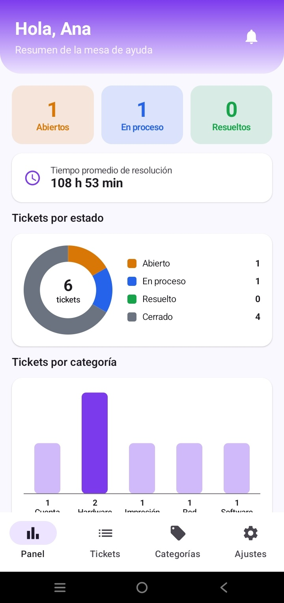 |

| Estado vacío con ilustración | Stepper |
|---|---|
| 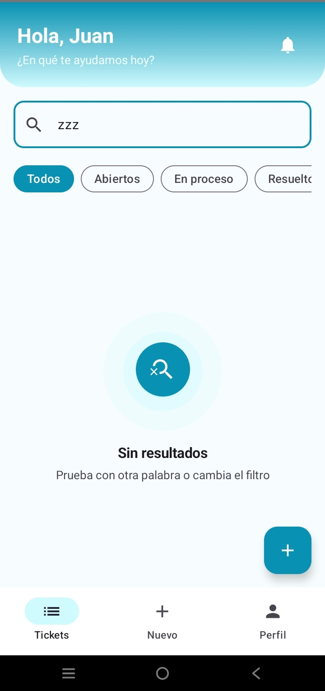 | 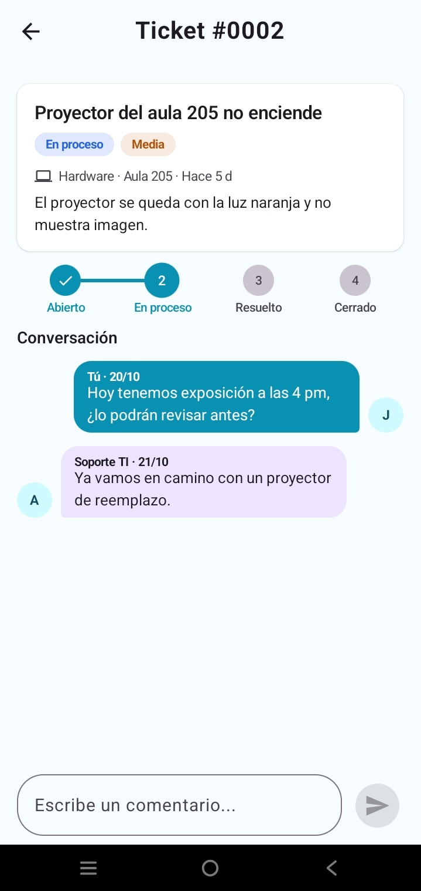 |

**Que tuve que corregir yo:**
- El avatar de mis propios mensajes mostraba la letra **"T"** (de "Tú") en vez de la inicial del autor, y mis notas internas salían a la izquierda como si las hubiera escrito otra persona. Le pedí que usara la inicial de `autorNombre` y que las notas internas también respetaran `esPropio`.
- Durante un intento, Gemini falló por conexión (`UNAVAILABLE: Unable to resolve host`). Revisé con `git status` que no quedaran cambios a medias antes de reintentar.
- Revisé que ningún archivo fuera de `ui/` cambiara y que no se agregaran librerías como Lottie.
  **Respeta MVVM?:** Sí. Todo está en la capa View; el nombre del saludo llega por parámetro desde la navegación, sin funciones nuevas en los ViewModels.

---

## Prompt 7 — Botón de notificaciones con función

**Texto enviado a Gemini:**
```
El botón de notificaciones de la cabecera en MisTicketsScreen y PanelScreen no hace nada. Dale función SOLO en la capa View, usando estados que ya existen en los ViewModels:
- Muestra el icono dentro de BadgedBox con un Badge con el número de pendientes; si es 0, sin Badge.
- Estudiante: cuenta los tickets Resueltos; al tocarlo, aplica el filtro de Resueltos.
- Soporte: cuenta los tickets ALTA sin atender de la alerta del panel; al tocarlo, navega a la Bandeja.
- Si la preferencia de notificaciones está desactivada, no muestres el botón.
```

**Prompt de corrección:**
```
Hay un bug: el badge del estudiante usa cantidadResueltos, que también cuenta los tickets CERRADOS. En MisTicketsViewModel agrega un StateFlow<Int> pendientesCalificar que cuente solo los tickets RESUELTO del estudiante (sin el filtro ni la búsqueda aplicados). No cambies cantidadResueltos, porque lo usa el resumen. El badge usa pendientesCalificar.
```

**Que genero la IA:** En el Prompt 6C, Gemini agregó por su cuenta una campanita en la cabecera **sin ninguna función** (`onClick` vacío). Con este prompt le dio un badge con pendientes, navegación y la conexión con el switch de Notificaciones.

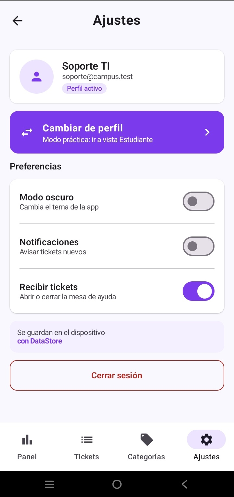

**Que tuve que corregir yo:**
- No acepté un botón decorativo: si está en la pantalla, debe hacer algo.
- **Al probar:** califiqué y cerré un ticket, el filtro Resueltos quedó vacío, pero la campanita seguía en **2**. Gemini había reutilizado `cantidadResueltos`, que también incluye los cerrados. Pedí un contador propio en el ViewModel.
- Comprobé que el badge baja solo: no es una lista guardada, es un estado derivado de los tickets que se actualiza con `Flow` cuando el pendiente se atiende.
  **Respeta MVVM?:** Sí. Qué cuenta como "pendiente" es una regla de negocio, por eso el contador quedó en el ViewModel y no en la pantalla.

---

## Prompt 8 — Pantalla de inicio (Splash) según el mockup

**Texto enviado a Gemini:**
```
Rediseña SplashScreen según el mockup del laboratorio, SOLO en ui/ y NavAyuda: logo de chat en un cuadro primary, "AyudaCampus" y "Reporta y sigue tus incidencias", tres tarjetas con los iconos Computer, Wifi y Print, un botón "Comenzar" que va a Registro y un TextButton "Ya tengo una cuenta" que va al Login. Si ya hay una sesión guardada, el Splash sigue llevando directo a la pantalla principal sin mostrar los botones. El logo entra con scaleIn + fadeIn y las tarjetas aparecen una tras otra.
```

**Que genero la IA:** La pantalla de inicio con el logo, las tres tarjetas de incidencias típicas, los botones y la animación de entrada.

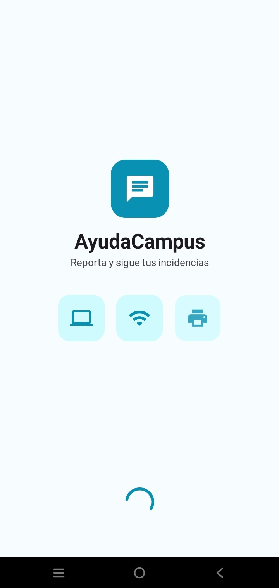

**Que tuve que corregir yo:** Al revisar la app contra los mockups del PDF, noté que mi Splash no tenía los botones "Comenzar" y "Ya tengo una cuenta". Verifiqué que, con una sesión guardada, la app siga entrando directo, para no romper la prueba de aceptación "el perfil se recuerda".

**Respeta MVVM?:** Sí. La decisión de a dónde ir sale del `SesionViewModel` que ya existía; la pantalla solo recibe los eventos `onComenzar` y `onTengoCuenta`.
 
---

## Reflexion (5 lineas)

- **Qué mejoró la IA y qué no:** Gemini acelera mucho el código repetitivo (consultas, StateFlow, animaciones de Compose), pero no prueba la app: errores como el SLA partido letra por letra o el badge que contaba cerrados solo aparecieron al usarla en el celular.
- **Qué error cometió:** Reutilizó un contador pensado para otra cosa, agregó un botón sin función y puso el avatar con la letra equivocada. Además, se cortó por cuota a mitad de un cambio de base de datos.
- **Qué aprendí sobre MVVM:** Dar las reglas de arquitectura en cada prompt evitó que Gemini pusiera lógica en la View. Filtrar las notas internas en el ViewModel hace que el estudiante nunca reciba el dato, no solo que no lo vea.
- **Sobre Room:** Cambiar una entidad obliga a subir la versión de la base; para la práctica usé `fallbackToDestructiveMigration`, pero en una app real haría una migración para no perder datos.
- **Sobre reglas de negocio:** El SLA, el pendiente de calificar y el correo único son reglas de negocio, por eso viven en el ViewModel o en el DAO y no en el Composable. Git (`git status`, Revert all) fue clave para recuperarme cuando la IA dejaba cambios a medias.